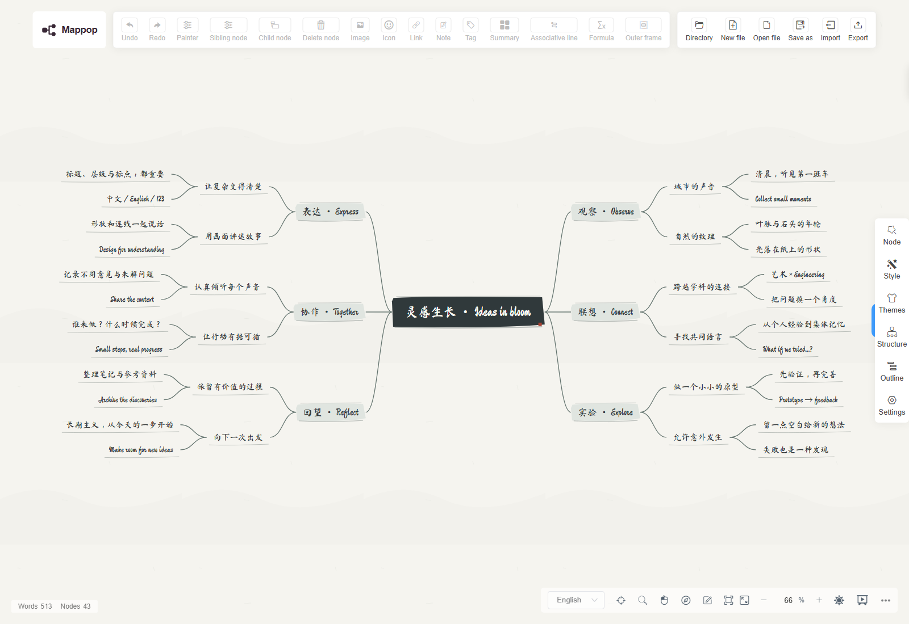
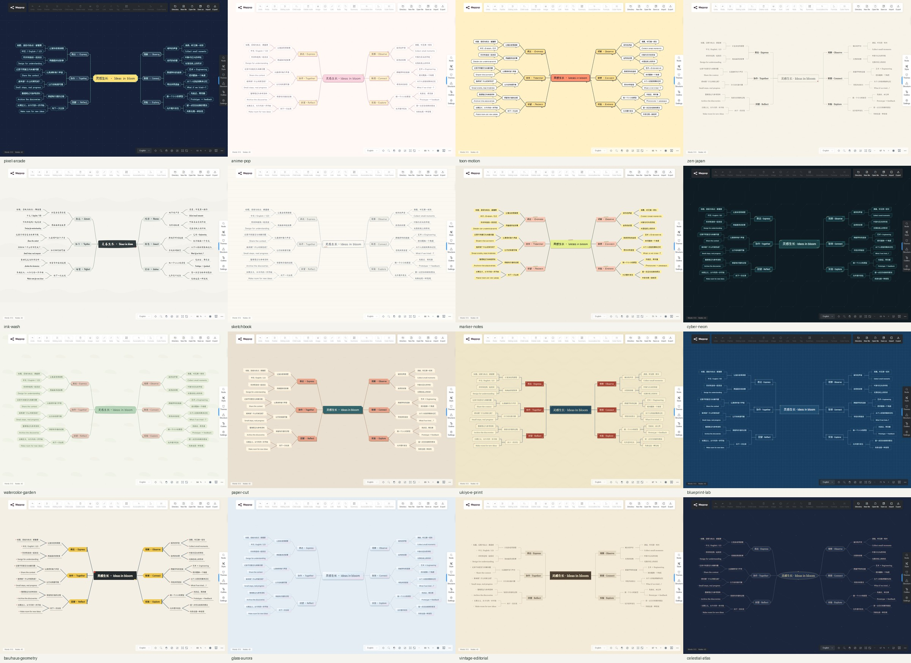
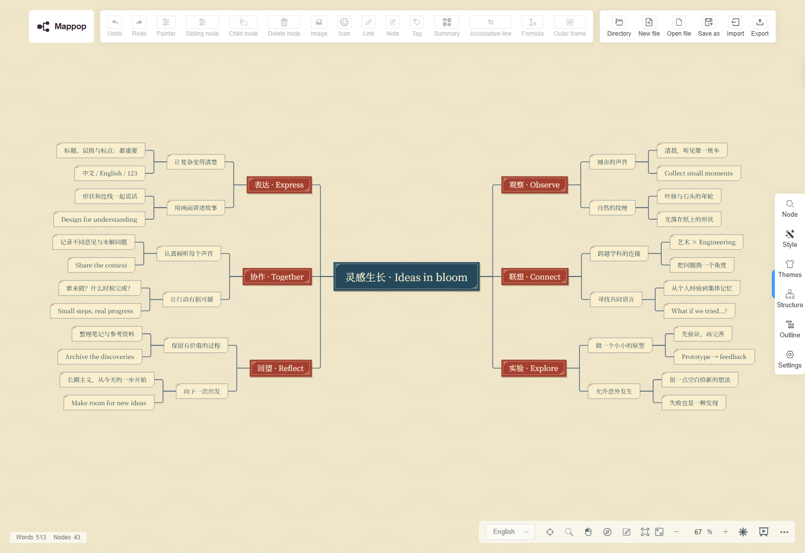
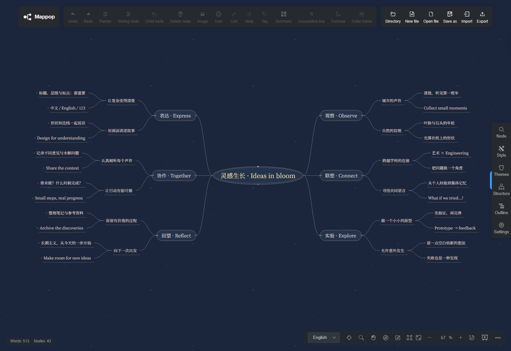
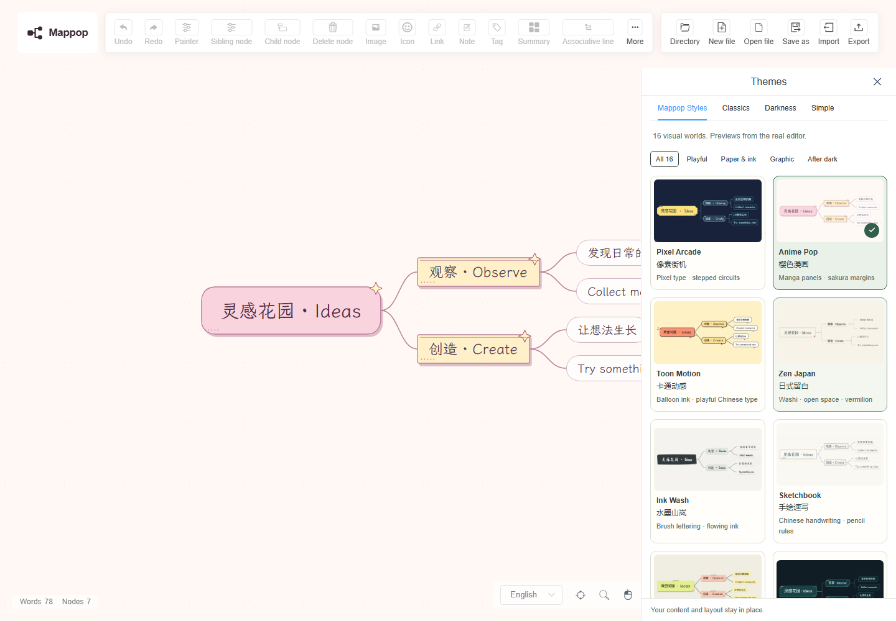

<p align="center">
  <a href="https://mappop.seiya-api.workers.dev" title="Open the Mappop editor">
    
  </a>
</p>

<div align="center">

**A little idea studio for big, beautifully tangled thoughts.**<br />
A free, open-source mind map editor with expressive themes, intuitive editing, and an optional Markdown-to-map API.

<p>
  <a href="https://mappop.seiya-api.workers.dev"></a>
</p>

<a href="LICENSE"></a>
<a href="https://github.com/seiya058904/Mappop/actions/workflows/deploy.yml"></a>

<p>
  <a href="#sixteen-visual-worlds">🎨 Explore the themes</a> &nbsp;·&nbsp;
  <a href="#make-your-first-map">✨ Get started</a> &nbsp;·&nbsp;
  <a href="#markdown-to-mind-map">🔗 Map API</a> &nbsp;·&nbsp;
  <a href="#run-locally">🛠 Run locally</a>
</p>

<sub>Browser-based · No account required for the editor · No in-app AI subscription</sub>

</div>

---

## ✨ Ideas look better when they can grow

Mappop is a reimagined home for the open-source [Simple mind map](https://github.com/wanglin2/mind-map) editor. It keeps the practical editing tools you expect and gives your ideas sixteen distinctive visual worlds to live in.

<p align="center">
  <a href="docs/assets/v1.1/after/ink-wash.png"></a>
  <sub>Actual desktop browser capture · Click to see the full-size image</sub>
</p>

<table>
  <tr>
    <td width="50%" valign="top"><strong>🧠 Think without friction</strong><br />Edit with double-click, branch with <code>Tab</code>, add siblings with <code>Enter</code>, and rearrange ideas by dragging. Rich text, links, notes, images, outlines, and undo/redo are inherited from the editor.</td>
    <td width="50%" valign="top"><strong>🎨 Make it feel like yours</strong><br />Switch between sixteen original Mappop art styles and the upstream theme collection. The editor keeps the map content and layout while you change its appearance.</td>
  </tr>
  <tr>
    <td valign="top"><strong>📦 Take your ideas anywhere</strong><br />Import supported formats and export editable <code>.smm</code> / JSON, or create PNG, SVG, PDF, XMind, Markdown, and TXT copies.</td>
    <td valign="top"><strong>🔗 Connect your own tools</strong><br />An optional, authenticated Markdown API turns a structured outline into a shareable map link—useful for your scripts and external AI agents without adding an in-app model provider.</td>
  </tr>
</table>

## 🎨 Sixteen visual worlds

**[Open Mappop online →](https://mappop.seiya-api.workers.dev/)**

十六种画风，同一份灵感。Chinese pixel lettering, brush calligraphy, pencilled
notes, printed cartouches, layered paper and orbital diagrams share the same
native editor. Content and structure stay in place when you change themes.

[](docs/assets/v1.1/after/contact-sheet.jpg)

Actual Chromium editor captures at 1600×1100, with the same four-level document.
[Unlabelled overview](docs/assets/v1.1/after/contact-sheet-unlabelled.jpg) ·
[Before/after audit](docs/ART-AUDIT.md) · [Design details](docs/THEMES.md)

| Theme / 主题 | Visual character |
| --- | --- |
| [Pixel Arcade / 像素街机](docs/assets/v1.1/after/pixel-arcade.png) | Chinese pixel type, stepped frames and square circuits |
| [Anime Pop / 樱色漫画](docs/assets/v1.1/after/anime-pop.png) | Sakura panels, handwritten Chinese and fine halftone |
| [Toon Motion / 卡通动感](docs/assets/v1.1/after/toon-motion.png) | Comic Chinese lettering and integrated speech balloons |
| [Zen Japan / 日式留白](docs/assets/v1.1/after/zen-japan.png) | Washi, fine rules, unboxed leaves and a vermilion seal |
| [Ink Wash / 水墨山岚](docs/assets/v1.1/after/ink-wash.png) | Brush calligraphy, uneven ink blocks and flowing branches |
| [Sketchbook / 手绘速写](docs/assets/v1.1/after/sketchbook.png) | Chinese pen lettering, double pencil contours and notebook rules |
| [Marker Notes / 马克便签](docs/assets/v1.1/after/marker-notes.png) | Folded taped headings and broad highlighter leaves |
| [Cyber Neon / 赛博霓虹](docs/assets/v1.1/after/cyber-neon.png) | Cut terminals, amber hardware marks and controlled teal light |
| [Watercolor Garden / 水彩花园](docs/assets/v1.1/after/watercolor-garden.png) | Pigment edges, botanical colors and soft paper |
| [Paper Cut / 纸艺拼贴](docs/assets/v1.1/after/paper-cut.png) | Layered cut paper, folded corners and offset depth |
| [Ukiyo-e Print / 浮世木版](docs/assets/v1.1/after/ukiyo-e-print.png) | Indigo/vermilion woodblock cartouches and subtle waves |
| [Blueprint Lab / 工程蓝图](docs/assets/v1.1/after/blueprint-lab.png) | Dimension lines, dashed outlines and a quiet drafting grid |
| [Bauhaus Geometry / 包豪斯几何](docs/assets/v1.1/after/bauhaus-geometry.png) | Primary geometry, half-circle headings and open leaves |
| [Glass Aurora / 极光玻璃](docs/assets/v1.1/after/glass-aurora.png) | Opal glass, fine highlights and exportable spectral light |
| [Vintage Editorial / 复古书刊](docs/assets/v1.1/after/vintage-editorial.png) | Chinese serif typography, letterpress rules and warm book paper |
| [Celestial Atlas / 星象图鉴](docs/assets/v1.1/after/celestial-atlas.png) | Concentric title orbits, star terminals and gold/silver lines |

### A closer look

[](docs/assets/v1.1/after/ukiyo-e-print-detail.png)

[](docs/assets/v1.1/after/celestial-atlas-detail.png)

[](docs/assets/v1.1/theme-selector.png)

<details>
<summary><strong>Mobile and large maps</strong></summary>

[390px screenshots](docs/assets/v1.1/after/contact-sheet-mobile.jpg) ·
[121-node density](docs/assets/v1.1/after/contact-sheet-121.jpg)

The starter map uses a compact mobile layout. Existing maps keep their chosen
layout: use zoom, pan and branch collapse to read large documents. Fit-to-canvas
is a navigation overview, not a promise that 121 labels fit legibly on a phone.
Testing uses Chromium emulation; physical phones and Safari/Firefox were not tested.

</details>

## 🚀 Make your first map

1. **[Open Mappop](https://mappop.seiya-api.workers.dev).** The example map is already editable; there is no sign-up step.
2. **Follow a thought.** Double-click any node to type, press `Tab` to grow a child branch, or use `Enter` to add a sibling. Drag nodes to reorganize.
3. **Choose a visual world.** Open **Themes** for the sixteen Mappop styles, or **Structure** to try another layout.
4. **Keep a copy.** Export an editable `.smm` file or another supported format before you close the browser or clear its data.

> [!IMPORTANT]
> Browser storage is convenient for continuing a draft, **not a durable backup**. Export important maps. Mappop does not include user accounts, cloud collaboration, or automatic cross-device sync.

## 🔗 Markdown to mind map

Have an outline already? Mappop can turn structured Markdown into a map that opens in the editor. This is a **small sharing API**, not an LLM: your script or agent produces the outline; Mappop displays it.

```sh
curl -X POST https://mappop.seiya-api.workers.dev/api/maps \
  -H "Authorization: Bearer $MAPPOP_API_TOKEN" \
  -H "Content-Type: application/json" \
  --data '{"markdown":"# A new project\n## Discover\n- Find the problem\n- Collect ideas\n## Create\n- Make a prototype\n- Share the result"}'
```

The API responds with an editor `url` and a public `markdownUrl`. **Creating a draft requires the deployment owner's write token.** The public demo does not provide a token to visitors; self-host Mappop to configure one for your own automation. Never expose that secret in frontend code or a public repo.

| Write | Read | Important limits |
| :--- | :--- | :--- |
| Authenticated `POST /api/maps` | Public `GET /api/maps/:id.md` | One root heading, supported nested headings/lists, up to **500 nodes** and **12 levels** |

> [!WARNING]
> **Anyone with the generated URL can read the stored draft.** Links do not automatically expire. That original draft is immutable; changes you make later in the editor stay in your browser and do not update the stored copy. Do not use public draft links for sensitive material.

The [API guide](docs/API.md) covers syntax, request limits, quotas, retention, error responses, and a PowerShell example. The machine-readable contract is in [`docs/openapi.json`](docs/openapi.json).

## 🛠 Run locally

Mappop includes the Vue editor, mind-map engine, and a Cloudflare Worker that serves the site and API together. You'll need **Node.js 22 or 24**, npm, and the project's locked dependencies.

```sh
git clone https://github.com/seiya058904/Mappop.git
cd Mappop
npm ci
npm run setup
npm run build
npm run db:local
npm run dev
```

Open **http://localhost:8787**. The editor works without an API token; creating drafts through the API requires your own local `.dev.vars` secret (see [deployment instructions](docs/DEPLOYMENT.md)). The build uses an OpenSSL compatibility flag only for the inherited Vue 2 / webpack 4 toolchain.

<details>
<summary><strong>🧪 Tests, deployment, and repository layout</strong></summary>

Run the existing checks:

```sh
npm test
npx playwright install chromium
npm run test:e2e
```

The v1.1.0 verification covers **12 API tests, 3 art-resource checks and 16 Chromium browser tests**, including the production editor, styles, map links, import/export, and a mobile-sized viewport. See the [verification report](docs/QA.md) and [publishing workflow](.github/workflows/deploy.yml). These results do not certify physical mobile devices or Safari/Firefox.

For your own public deployment, configure a **Cloudflare Workers + D1** project, a database, rate-limit bindings, and a write token. Do not reuse the maintainer's account/database IDs. Start with [deployment instructions](docs/DEPLOYMENT.md).

```text
web/                 Browser editor and Mappop themes
simple-mind-map/      Upstream mind-map engine
worker/              Markdown draft API
migrations/          D1 schema
scripts/             Build helpers
docs/                Guides, screenshots, verification
.github/workflows/   CI and deployment
```

</details>

## 💜 Made possible by open source

Mappop is an independent derivative of [**wanglin2 / Simple mind map**](https://github.com/wanglin2/mind-map), built from upstream commit [`e8e5ef9`](https://github.com/wanglin2/mind-map/commit/e8e5ef9c41bc13ca7b13084e078123adff002242). Original history and copyright notices are retained. Mappop is **not** an official upstream release.

The source is under the [MIT license](LICENSE). The separately installed open-source theme plugin declares ISC, and bundled fonts retain their own terms. Please see [NOTICE](NOTICE), [upstream provenance](docs/UPSTREAM.md), and [asset licenses](web/public/mappop/ASSETS.md) for the details. Mappop does not include upstream's separate closed-source desktop products or their assets.

<p align="center">
  <sub>Made for the ideas that don't fit inside a straight line. ✦</sub><br />
  <a href="https://mappop.seiya-api.workers.dev">Open Mappop</a> · <a href="https://github.com/seiya058904/Mappop/issues">Feedback &amp; issues</a> · <a href="docs/QA.md">Release verification</a>
</p>
