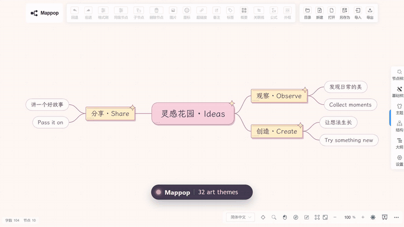
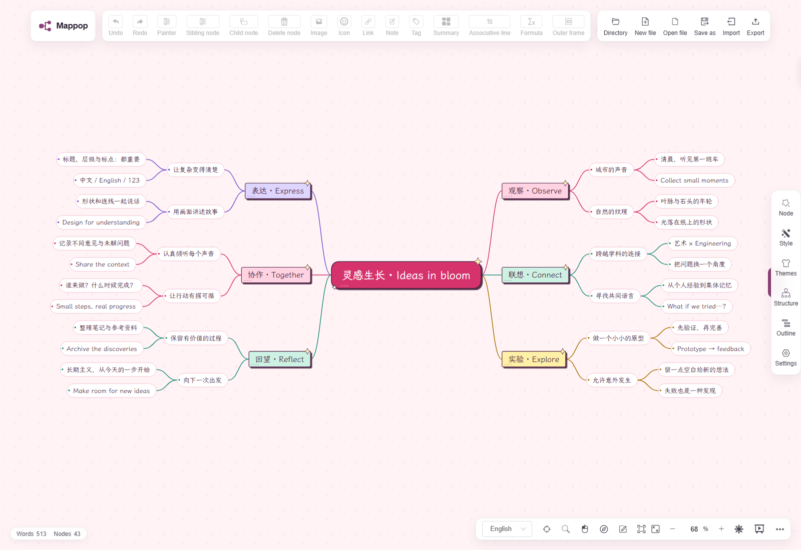
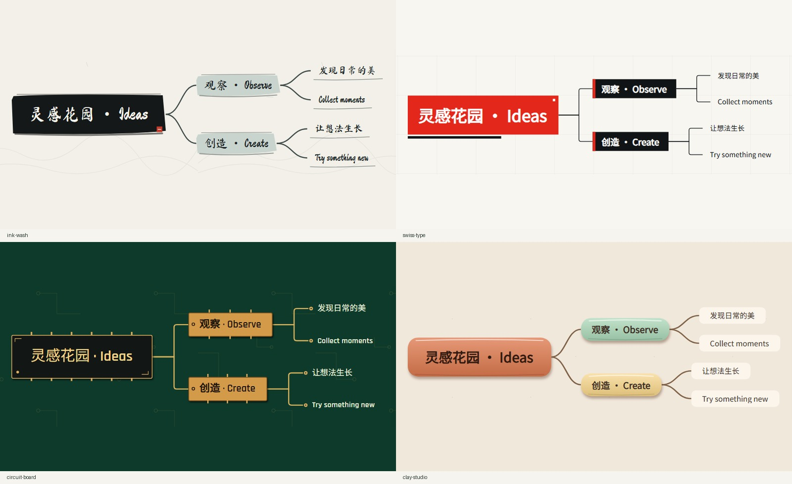
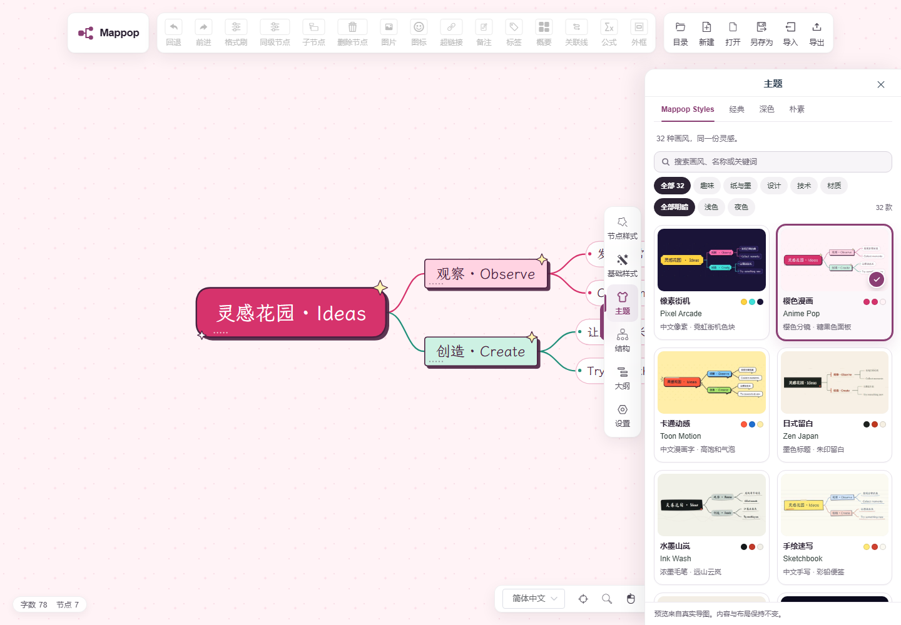

<a id="top"></a>

<h1 align="center">Mappop</h1>

<p align="center">
  <strong>Mind mapping, with a little more character.</strong>
</p>

<p align="center">
  <a href="https://mappop.seiya-api.workers.dev" title="Open the Mappop editor">
    
  </a>
</p>

<div align="center">

A free, open-source mind map editor with expressive themes, intuitive editing, and an optional Markdown-to-map API.

<p>
  <a href="https://mappop.seiya-api.workers.dev"></a>
</p>

<p>
<a href="LICENSE"></a>
<a href="https://github.com/seiya058904/Mappop/releases/tag/v1.2.0"></a>
<a href="https://github.com/seiya058904/Mappop/actions/workflows/deploy.yml"></a>
</p>

<p>
  <a href="#features">Features</a> ·
  <a href="#themes">Theme gallery</a> ·
  <a href="#quick-start">Quick start</a> ·
  <a href="#ai-import">AI-assisted import</a> ·
  <a href="#export">Export</a> ·
  <a href="#api">API</a> ·
  <a href="#self-host">Self-host</a> ·
  <a href="#faq">FAQ</a>
</p>

<sub>Browser-based · No account required for the editor · No in-app AI subscription</sub>

<p>
  <a href="docs/assets/promo/mappop-loop.mp4"></a><br />
  <sub>One map, five of the thirty-two themes. Real editor captures; the ripple and label are added for the loop. <a href="docs/assets/promo/mappop-loop.mp4">MP4</a></sub>
</p>

</div>

---

<a id="features"></a>

## A canvas for connected thinking

A reading note, a project plan, a story that is still finding its shape. Give each thought room to branch—and let the whole map feel like yours.

Mappop is a reimagined home for the open-source [Simple mind map](https://github.com/wanglin2/mind-map) editor. It keeps the practical editing tools you expect and gives your ideas thirty-two distinctive visual worlds to live in.

<p align="center">
  <a href="docs/assets/v1.3/after/anime-pop.png"></a><br />
  <sub>Anime Pop — an actual desktop capture. Click to explore the full-size map.</sub>
</p>

<table>
  <tr>
    <td width="50%" valign="top"><strong>🧠 Think without friction</strong><br />Edit with double-click, branch with <code>Tab</code>, add siblings with <code>Enter</code>, and rearrange ideas by dragging. Rich text, links, notes, images, outlines, and undo/redo are inherited from the editor.</td>
    <td width="50%" valign="top"><strong>🎨 Make it feel like yours</strong><br />Switch between thirty-two original Mappop art styles and the upstream theme collection. The editor keeps the map content and layout while you change its appearance.</td>
  </tr>
  <tr>
    <td valign="top"><strong>📦 Take your ideas anywhere</strong><br />Bring your own file, or use the ready-to-send prompt in <strong>Import</strong> to prepare an outline with an external AI. Export editable <code>.smm</code> / JSON, or create PNG, SVG, PDF, XMind, Markdown, and TXT copies.</td>
    <td valign="top"><strong>🔗 Connect your own tools</strong><br />An optional, authenticated Markdown API turns a structured outline into a shareable map link—useful for your scripts and external AI agents without adding an in-app model provider.</td>
  </tr>
</table>

**Make room for…** study notes and reading connections · project plans and decision branches · story outlines and character relationships · research summaries and presentation structures.

<a id="themes"></a>

## Thirty-two visual worlds

**[Open Mappop online →](https://mappop.seiya-api.workers.dev/)**

Chinese pixel lettering, brush calligraphy, pencilled
notes, printed cartouches, layered paper and orbital diagrams share the same
native editor. Content and structure stay in place when you change themes.
Switch directly from Themes to Node, Style, Structure, Outline or Settings using the adjacent sidebar controls, without closing the panel first—even on narrow screens.

### Distinct shapes, the same ideas

[](docs/THEMES.md)

Brush silhouettes, editorial baselines, copper component pins and matte clay relief.
These are real seven-node editor previews, with identical content. Each style
has its own root, branch, leaf and line rules; decorations become lighter deeper
in the map.

**[Explore all 32 styles](docs/THEMES.md)** ·
[32-theme 43-node gallery](docs/assets/v1.3/after/contact-sheet.jpg) ·
[Unlabelled comparison](docs/assets/v1.3/after/contact-sheet-unlabelled.jpg) ·
[Original 16 before/after](docs/ART-AUDIT.md)

<details>
<summary><strong>Find a style that fits</strong></summary>

[](docs/assets/v1.3/theme-selector.png)

Search Chinese or English names and style keywords. Combine **Playful**, **Paper
& ink**, **Graphic**, **Technical** or **Materials** with **Light / After dark**.
After dark includes Pixel Arcade. Chinese UI leads with Chinese names; every
card is reachable by scrolling and keyboard. Closing the panel restores focus.

[390px theme picker](docs/assets/v1.3/theme-selector-mobile.png) ·
[Font sources and coverage](web/public/mappop/fonts/ART-FONTS.md)

</details>

<details>
<summary><strong>Mobile and large maps</strong></summary>

[390px overview](docs/assets/v1.3/after/contact-sheet-mobile.jpg) ·
[121-node density](docs/assets/v1.3/after/contact-sheet-121.jpg) ·
[121-node reading detail](docs/assets/v1.3/after/contact-sheet-121-detail.jpg)

Existing maps keep their layout. Use zoom, pan and branch collapse to read large
documents; fit-to-canvas is a navigation overview. Chromium tests include 390px,
768px and desktop viewports, plus editing and collapse on 500-node maps.
Physical phones, Firefox and Safari/WebKit were not tested in this release.

</details>

<a id="quick-start"></a>

## From a thought to a map

1. **[Open Mappop](https://mappop.seiya-api.workers.dev).** The example map is already editable; there is no sign-up step.
2. **Follow a thought.** Double-click any node to type, press `Tab` to grow a child branch, or use `Enter` to add a sibling. Drag nodes to reorganize.
3. **Choose a visual world.** Open **Themes** for the thirty-two Mappop styles, or **Structure** to try another layout.
4. **Keep a copy.** Export an editable `.smm` file or another supported format before you close the browser or clear its data.

| While a node is selected | Action |
| --- | --- |
| <kbd>Tab</kbd> | Add a child node |
| <kbd>Enter</kbd> | Add a sibling node |
| Double-click | Edit its text |
| Toolbar **Undo / Redo** | Revisit a change |
| **Themes / Structure** | Change the visual style or layout |
| <kbd>Ctrl</kbd> + mouse wheel | Zoom the canvas |

Prefer zooming without a modifier key? In **Settings → Mouse wheel behavior**, choose **Zoom view**. You can also choose the zoom direction; the setting persists in your browser.

> [!IMPORTANT]
> Browser storage is convenient for continuing a draft, **not a durable backup**. Export important maps. Mappop does not include user accounts, cloud collaboration, or automatic cross-device sync.

<a id="ai-import"></a>

## Start with an idea, let AI help with the outline

You do not need to write a prompt or understand Markdown. The **Import** dialog includes a ready-to-send prompt that explains Mappop's file format and asks your external AI to guide the conversation.

1. **Copy the prompt.** Open **Import → Copy AI prompt**, then paste it unchanged into your preferred external AI chat.
2. **Talk about your map.** If you have not supplied a topic, the prompt instructs the AI to ask what you want to map and why. Answer in your own words or share source material. The instructions ask it to clarify only missing details, then generate the outline when it has enough information.
3. **Save the result.** Download `mindmap.md` if the AI can provide files. Otherwise, save the generated Markdown as a plain-text UTF-8 `.md` file, not a `.txt` or Word document.
4. **Bring it into Mappop.** Return to **Import**, select the `.md` file and confirm. Then edit the nodes, choose a theme and export your map. Import replaces the current map, so export it first if you want to keep it.

**View prompt** lets you read or manually copy the instructions if clipboard access is unavailable. The guidance is available in English, Simplified Chinese, Traditional Chinese and Vietnamese. It covers a single root heading, nested headings and lists, and a format example; review the AI's result before importing.

This file-based workflow needs **no Mappop API token or model configuration**. You use your own external AI service under its terms; Mappop supplies the prompt and imports the file, without calling a model or sending your map to that service. For automated link creation instead, see the [Markdown API](#api).

<a id="export"></a>

## Take the map with you

Choose the format for the next step:

| What you want to do | Format | What to expect |
| --- | --- | --- |
| Continue editing later | `.smm` / JSON | An editable map; `.smm` is the simplest native backup |
| Share in a message or slide | PNG | A fixed image, including the theme's fonts and background |
| Keep a scalable illustration | SVG | Vector output; the viewer needs embedded-font and `foreignObject` support |
| Read or distribute a document | PDF | A fixed-appearance document |
| Move an outline into another workflow | XMind / Markdown / TXT | Native export options; visual details depend on the destination format |

Image exports wait for the current theme fonts and layout, including immediately
after importing SMM. If a local font fails, the editor explains its fallback;
keep editing or save SMM, then reload before exporting images.

**See the actual output:** [SVG gallery](docs/assets/v1.3/svg-exports.jpg) · [PNG gallery](docs/assets/v1.3/png-exports.jpg) · [Download six representative SVG/PNG/PDF sets](https://github.com/seiya058904/Mappop/releases/download/v1.2.0/Mappop-v1.2.0-art-samples.zip).

These are exports from the same 43-node test document. The [QA report](docs/QA.md) records typography, decoration and independent SVG rendering checks.

<a id="api"></a>

## An outline in, a map out · Markdown API

Have an outline already? Mappop can turn structured Markdown into a map that opens in the editor. This is a **small sharing API**, not an LLM: your script or agent produces the outline; Mappop displays it.

```text
Your structured Markdown → authenticated POST /api/maps
                        → editor URL + public Markdown URL
```

Import a Markdown file through the editor for a local workflow, or expand the API example for automation.

<details>
<summary><strong>API quick example</strong></summary>

```sh
curl -X POST https://mappop.seiya-api.workers.dev/api/maps \
  -H "Authorization: Bearer $MAPPOP_API_TOKEN" \
  -H "Content-Type: application/json" \
  --data '{"markdown":"# A new project\n## Discover\n- Find the problem\n- Collect ideas\n## Create\n- Make a prototype\n- Share the result"}'
```

The API responds with an editor `url` and a public `markdownUrl`. **Creating a draft requires the deployment owner's write token.** The public demo does not provide a token to visitors; self-host Mappop to configure one for your own automation. Never expose that secret in frontend code or a public repo.

| Write | Read | Important limits |
| :--- | :--- | :--- |
| Authenticated `POST /api/maps` | Public `GET /api/maps/:id.md` | One root heading, supported nested headings/lists, up to **500 nodes** and **12 levels** |

> [!WARNING]
> **Anyone with the generated URL can read the stored draft.** Links do not automatically expire. That original draft is immutable; changes you make later in the editor stay in your browser and do not update the stored copy. Do not use public draft links for sensitive material.

The [API guide](docs/API.md) covers syntax, request limits, quotas, retention, error responses, and a PowerShell example. The machine-readable contract is in [`docs/openapi.json`](docs/openapi.json).

</details>

<a id="self-host"></a>

## Make yourself at home

Mappop includes the Vue editor, mind-map engine, and a Cloudflare Worker that serves the site and API together. You'll need **Node.js 22 or 24**, npm, and the project's locked dependencies.

```sh
git clone https://github.com/seiya058904/Mappop.git
cd Mappop
npm ci
npm run setup
npm run build
npm run db:local
npm run dev
```

Open **http://localhost:8787**. The editor works without an API token; creating drafts through the API requires your own local `.dev.vars` secret (see [deployment instructions](docs/DEPLOYMENT.md)). The build uses an OpenSSL compatibility flag only for the inherited Vue 2 / webpack 4 toolchain.

<details>
<summary><strong>🧪 Tests, deployment, and repository layout</strong></summary>

Run the existing checks:

```sh
npm test
npx playwright install chromium
npm run test:e2e
```

The v1.2.0 verification covers **12 API tests, 4 art/resource checks and 34 Chromium browser tests**. Coverage includes all 32 themes, standalone exports, saved maps, rich content, 500-node operations, slow/failed fonts, damaged preferences and keyboard/mobile flows. The [verification report](docs/QA.md) records local runs and limits; the [release](https://github.com/seiya058904/Mappop/releases/tag/v1.2.0) links the final CI and deployed revision.

For your own public deployment, configure a **Cloudflare Workers + D1** project, a database, rate-limit bindings, and a write token. Do not reuse the maintainer's account/database IDs. Start with [deployment instructions](docs/DEPLOYMENT.md).

```text
web/                 Browser editor and Mappop themes
simple-mind-map/      Upstream mind-map engine
worker/              Markdown draft API
migrations/          D1 schema
scripts/             Build helpers
docs/                Guides, screenshots, verification
.github/workflows/   CI and deployment
```

</details>

<a id="faq"></a>

## A few useful answers

<details>
<summary><strong>Is Mappop free? Do I need an account?</strong></summary>

The browser editor is free to use and does not require sign-up. The source code is MIT licensed; fonts and the separately installed theme plugin keep their own licenses. The optional API requires a deployment owner's token, which the public demo does not issue to visitors.

</details>

<details>
<summary><strong>Where does my map live? Are shared links private?</strong></summary>

Ordinary editing uses browser storage; export an editable backup for important work. API-created drafts are stored on the deployment's D1 database. Anyone with the generated URL can read that original draft, and links do not automatically expire. Later browser edits do not update the stored draft. See the [API guide](docs/API.md) before sharing sensitive material.

</details>

<details>
<summary><strong>Will changing themes change my content?</strong></summary>

Theme changes preserve text, tree structure, images and relationship data. Fonts and spacing can cause reasonable reflow. Explicit manual node geometry and styling take precedence over the new art decorations. The original eight theme identifiers remain compatible with saved documents.

</details>

<details>
<summary><strong>How well do Chinese text and large maps work?</strong></summary>

The local Chinese font subsets cover GB2312, with a bundled Sans fallback for 116 characters missing from the pixel face. Rare and traditional characters beyond the subsets depend on platform fonts. Long bilingual labels, 121-node examples and 500-node editing were checked; large maps still need zoom, pan or collapse.

</details>

<details>
<summary><strong>Can I use it on my phone or in another browser?</strong></summary>

The interface includes a compact mobile toolbar and a responsive theme picker. Verification covers Windows/Linux Chromium and a 390px emulated viewport. Physical phones, Safari and Firefox are not certified by this release. SVG compatibility also varies by viewer; choose PNG/PDF for fixed appearance.

</details>

## Explore further

| Start here | Find out more |
| --- | --- |
| [Theme design](docs/THEMES.md) | Shapes, typography, materials and rendering rules |
| [Visual audit](docs/ART-AUDIT.md) | Original-eight findings and before/after comparisons |
| [QA and limitations](docs/QA.md) | Test evidence, performance samples and browser scope |
| [API guide](docs/API.md) · [OpenAPI](docs/openapi.json) | Requests, limits, quotas and sharing semantics |
| [Deployment](docs/DEPLOYMENT.md) | Local secrets, Workers, D1 and publishing |
| [Changelog](CHANGELOG.md) | What's changed between releases |

**Have a better idea or found a rough edge?** [Open an issue](https://github.com/seiya058904/Mappop/issues) with the browser, theme, steps to reproduce and a small non-sensitive example. For a visual change, include a real before/after capture. Keep pull requests focused and run the relevant checks above.

## Built on generous work

Mappop is an independent derivative of [**wanglin2 / Simple mind map**](https://github.com/wanglin2/mind-map), built from upstream commit [`e8e5ef9`](https://github.com/wanglin2/mind-map/commit/e8e5ef9c41bc13ca7b13084e078123adff002242). Original history and copyright notices are retained. Mappop is **not** an official upstream release.

The source is under the [MIT license](LICENSE). The separately installed open-source theme plugin declares ISC, and bundled fonts retain their own terms. Please see [NOTICE](NOTICE), [upstream provenance](docs/UPSTREAM.md), and [asset licenses](web/public/mappop/ASSETS.md) for the details. Mappop does not include upstream's separate closed-source desktop products or their assets.

Chinese typography draws on Fusion Pixel, LXGW WenKai, ZCOOL KuaiLe, Ma Shan Zheng, Noto Sans SC and Noto Serif SC. Their [sources, licenses and subset coverage](web/public/mappop/fonts/ART-FONTS.md) are recorded alongside the local assets.

---

<p align="center">
  <strong>Make room for the next idea.</strong><br />
  <a href="https://mappop.seiya-api.workers.dev">Open Mappop →</a> · <a href="https://github.com/seiya058904/Mappop/issues">Feedback &amp; issues</a> · <a href="#top">Back to top ↑</a>
</p>
