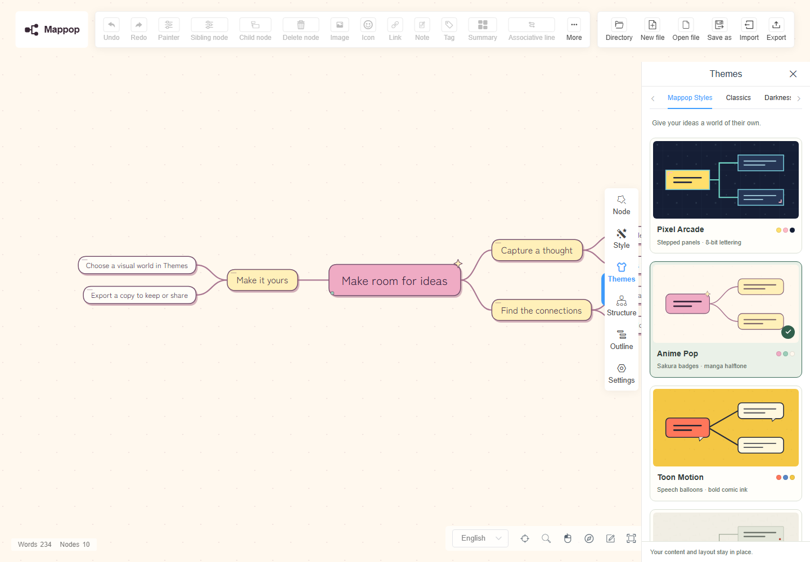

<p align="center"></p>

<p align="center">An open-source canvas for ideas, with expressive visual themes and a practical map API.</p>

<p align="center"><strong><a href="https://mappop.seiya-api.workers.dev">Open Mappop →</a></strong> · <a href="#run-locally">Run locally</a> · <a href="docs/API.md">API guide</a> · <a href="docs/UPSTREAM.md">Upstream & licenses</a> · <a href="https://github.com/seiya058904/Mappop/issues">Feedback</a></p>

Mappop brings a fresh visual identity to the open-source [Simple mind map](https://github.com/wanglin2/mind-map) editor. Start with an idea, grow it into branches, and give it a visual world of its own. The familiar editing engine stays at the center: rich text, notes, links, images, outlines, layout choices, undo/redo, and import/export.

## A canvas with character

Eight original theme families change more than a color swatch. Typography, node shapes, line treatment, spacing, and lightweight backgrounds work together.

<p align="center"><a href="docs/assets/styles/theme-selector.png"></a></p>

| Theme | Character |
| --- | --- |
| [Pixel Arcade](docs/assets/styles/pixel-arcade.png) | Stepped panels and 8-bit Silkscreen lettering |
| [Anime Pop](docs/assets/styles/anime-pop.png) | Sakura badges, manga halftone, and rounded Zen Maru type |
| [Toon Motion](docs/assets/styles/toon-motion.png) | Speech balloons and bold Bangers lettering |
| [Zen Japan](docs/assets/styles/zen-japan.png) | Washi paper, vermilion seals, and Zen Old Mincho |
| [Ink Wash](docs/assets/styles/ink-wash.png) | Ink contours and a light rice-paper surface |
| [Sketchbook](docs/assets/styles/sketchbook.png) | Pencil contours, notebook rules, and Caveat handwriting |
| [Marker Notes](docs/assets/styles/marker-notes.png) | Taped notes and Permanent Marker lettering |
| [Cyber Neon](docs/assets/styles/cyber-neon.png) | Circuit corners, luminous connections, and Rajdhani type |

The editor also retains the upstream open-source theme collection. Mappop includes no in-app LLM, API-key setup, or commercial desktop-client promotion. Use an external script or agent with the map API when you need automation.


<details>
<summary>Mobile view</summary>


</details>

## Start making a map

- Double-click a node to edit. Press **Tab** for a child or **Enter** for a sibling.
- On a phone, the starter map opens as a compact vertical map. Tap a branch's numbered control to expand its ideas.
- Open **Themes** to change the visual style, or **Structure** to change the layout.
- Import a supported document, or export an editable `.smm` / JSON copy. The editor also exports PNG, SVG, PDF, XMind, Markdown, and TXT.
- The editor keeps its current draft in browser storage. Export copies for backup; browser storage is not a durable archive. Direct folder/file editing depends on browser support and HTTPS.

## Map API

Create a map from structured Markdown, then open the returned URL in the editor. The API has no model-provider dependency.

```sh
curl -X POST https://mappop.seiya-api.workers.dev/api/maps \
  -H "Authorization: Bearer $MAPPOP_API_TOKEN" \
  -H "Content-Type: application/json" \
  --data '{"markdown":"# A weekend idea\n## Explore\n- Visit the market\n- Take the scenic route\n## Make\n- Cook something new"}'
```

A successful request returns `201` with `id`, `title`, `nodeCount`, `createdAt`, `url` (the editor link), and `markdownUrl`. Creation requires the deployment owner's write token; self-host to use your own. Keep it in your external script or server environment. **Anyone with a generated link can read the map.** Links do not expire; editor changes stay in the browser and do not overwrite the stored original.

The API accepts one top-level heading and structured child headings/lists, with up to 500 nodes and 12 levels. See the [API guide](docs/API.md) for the exact grammar, body limits, rate limits, and storage behavior.

## Run locally

Use Node.js 22 or 24 and npm. From the repository root:

```sh
npm ci
npm run setup
npm run build
npm run db:local
npm run dev
```

Open [localhost:8787](http://localhost:8787). The build writes the static editor to `.output/public`; the development Worker serves the editor and API together. See the [API guide](docs/API.md) for local token setup. The inherited Vue 2 / webpack 4 toolchain uses an OpenSSL compatibility option scoped to the build process.

```sh
npm test            # API checks
npx playwright install chromium
npm run test:e2e    # browser checks
```

See [release verification](docs/QA.md) for the tested workflows and practical limits.

## Deploy

Mappop targets Cloudflare Workers with static assets and D1 map storage. Build first, configure the bindings and write token, then deploy through the project workflow. See [deployment instructions](docs/DEPLOYMENT.md). Deployment requires your own Cloudflare account; the editor itself needs no model-provider credentials.

## Project layout

```text
web/                  Vue editor and Mappop theme assets
simple-mind-map/       Upstream JavaScript editing engine
docs/                 API, deployment, provenance, and screenshots
.github/              CI and contribution templates
```

## Built on open source

Mappop is an independent derivative of [wanglin2/mind-map](https://github.com/wanglin2/mind-map), based on commit [`e8e5ef9`](https://github.com/wanglin2/mind-map/commit/e8e5ef9c41bc13ca7b13084e078123adff002242), with upstream Git history retained. The original [MIT license](LICENSE) and copyright notice are preserved. The separately installed `simple-mind-map-plugin-themes@1.0.0` declares ISC; bundled fonts retain their own license files.

See [NOTICE](NOTICE), [UPSTREAM](docs/UPSTREAM.md), and [asset provenance](web/public/mappop/ASSETS.md) for attribution and the boundary between the open-source editor and upstream's separately distributed closed-source products. Mappop's brand graphics and theme textures are original work for this project. Some SVG viewers substitute fonts or omit filters; use PNG or PDF when you need a fixed appearance.
